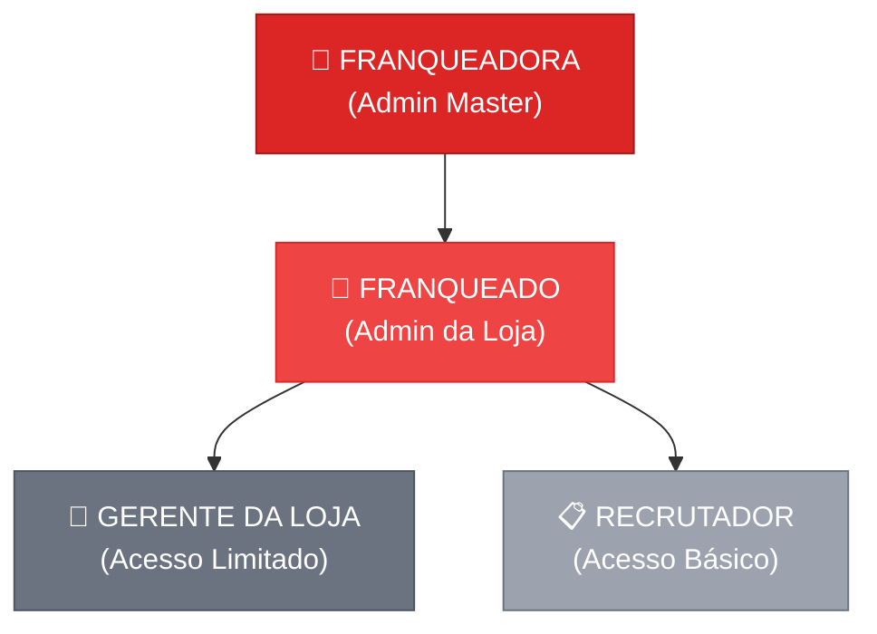

# 🔴 Sistema de RH Multi-Lojas — Gigante Pneus
## Documento de Brainstorming & Arquitetura

---

## 1. Visão Geral

Transformar o sistema de RH monolítico (single-tenant, feito para 1 empresa) em uma **plataforma multi-lojas/franquias** onde:

- A **Franqueadora** gerencia lojas, usuários e tem visão consolidada de tudo
- Cada **Franqueado** (dono de loja) tem autonomia total dentro da sua loja
- **Gerentes de loja** têm acesso limitado à triagem de candidatos + IA de match
- O **candidato externo** vê uma LP profissional, organizada por cidade e tipo de vaga

> **Base**: O sistema atual da pasta `curriculos abucci` (Gigante Produtos Médicos), com todas as funcionalidades de IA, Pesquisas, Vagas e Banco de Talentos já prontas.

---

## 2. Hierarquia de Acesso (4 Níveis)



### Permissões por Nível

| Funcionalidade | Franqueadora | Franqueado | Gerente | Recrutador |
|---|:---:|:---:|:---:|:---:|
| Dashboard consolidado (todas lojas) | ✅ | ❌ | ❌ | ❌ |
| Dashboard da loja | ✅ (com filtro) | ✅ | ❌ | ❌ |
| Criar/gerenciar lojas | ✅ | ❌ | ❌ | ❌ |
| Criar usuários (franqueados) | ✅ | ❌ | ❌ | ❌ |
| Criar usuários (gerente/recrutador) | ❌ | ✅ | ❌ | ❌ |
| Banco de Talentos (visualizar) | ✅ (todas) | ✅ (sua loja) | ✅ (sua loja) | ✅ (sua loja) |
| Criar/gerenciar vagas | ✅ | ✅ | ❌ | ❌ |
| Criar pesquisas internas | ✅ | ✅ | ❌ | ❌ |
| Ver pesquisas da franqueadora | ❌ invisível | ❌ invisível | ❌ | ❌ |
| Ver TODAS as pesquisas/resultados | ✅ | ❌ (só sua) | ❌ | ❌ |
| Análise de IA (pesquisas) | ✅ | ✅ | ❌ | ❌ |
| Análise de IA (triagem currículos) | ✅ | ✅ | ✅ | ✅ |
| Configurações (chaves API, prompts) | ✅ | ✅ | ❌ | ❌ |

---

## 3. Fluxos Principais

### 3.1 Fluxo da Franqueadora

```
1. Login como Admin Master
2. Dashboard → Visão consolidada de TODAS as lojas (com filtro por loja)
3. Gestão → Criar nova loja + gerar link de convite para o Franqueado
4. O Franqueado recebe o link por e-mail, cria sua senha e acessa
5. Franqueadora pode criar pesquisas globais (invisíveis para franqueados)
6. Franqueadora vê os resultados de TODAS as pesquisas de todas as lojas
```

### 3.2 Fluxo do Franqueado (Admin da Loja)

```
1. Recebe link de convite → Define sua senha
2. Login → Dashboard filtrado apenas para sua loja
3. Cria vagas (vinculadas à sua loja/cidade)
4. Cria pesquisas internas para sua equipe
5. Visualiza e faz triagem de candidatos com IA
6. Cria usuários internos (gerente, recrutador) para sua loja
```

### 3.3 Fluxo do Gerente da Loja

```
1. Recebe credenciais do Franqueado
2. Login → Acesso apenas ao Banco de Talentos da sua loja
3. Visualiza candidatos e aciona IA de match para triagem
4. NÃO cria vagas, pesquisas nem usuários
```

### 3.4 Fluxo do Candidato (Público)

```
1. Acessa a LP pública (via link, WhatsApp ou QR Code na loja)
2. Vê um painel profissional com filtros por CIDADE e TIPO DE VAGA
3. Clica na vaga → Landing Page detalhada (responsabilidades, requisitos, benefícios)
4. Clica "Candidatar-se" → Formulário de cadastro + upload de currículo (MinIO)
5. Dados caem no banco vinculados à loja/vaga
```

---

## 4. Landing Page Pública (Proposta de UX)

> **Objetivo**: O candidato deve ter 2 impressões: **empresa grande** e **empresa organizada**.

### Proposta: "Portal de Carreiras Gigante Pneus"

```
┌──────────────────────────────────────────────────────────┐
│  🔴 GIGANTE PNEUS — TRABALHE CONOSCO                    │
│  [Logo]                           [Entrar (RH)]         │
├──────────────────────────────────────────────────────────┤
│                                                          │
│  ██████████████████████████████████████████████████████  │
│  █                                                    █  │
│  █    BANNER HERO — GIGANTE PNEUS                     █  │
│  █    "Sua carreira começa aqui. Faça parte do        █  │
│  █     maior grupo de autocenters do Brasil."         █  │
│  █                                                    █  │
│  ██████████████████████████████████████████████████████  │
│                                                          │
│  ┌─────────────────┐  ┌──────────────────┐               │
│  │ 📍 Filtrar por  │  │ 🔧 Filtrar por   │               │
│  │    CIDADE  ▼    │  │    TIPO DE VAGA ▼│               │
│  └─────────────────┘  └──────────────────┘               │
│                                                          │
│  ── Goiânia ─────────────────────────────────────────    │
│  ┌─────────────┐ ┌─────────────┐ ┌─────────────┐        │
│  │ Mecânico    │ │ Vendedor    │ │ Auxiliar     │        │
│  │ Automotivo  │ │ de Balcão   │ │ Estoque     │        │
│  │ 📍Goiânia   │ │ 📍Goiânia   │ │ 📍Goiânia   │        │
│  │ Presencial  │ │ Presencial  │ │ Presencial  │        │
│  │ [Ver Vaga →]│ │ [Ver Vaga →]│ │ [Ver Vaga →]│        │
│  └─────────────┘ └─────────────┘ └─────────────┘        │
│                                                          │
│  ── Ribeirão Preto ──────────────────────────────────    │
│  ┌─────────────┐ ┌─────────────┐                         │
│  │ Gerente de  │ │ Mecânico    │                         │
│  │ Loja        │ │ Alinhamento │                         │
│  │ 📍Rib. Preto│ │ 📍Rib. Preto│                         │
│  │ [Ver Vaga →]│ │ [Ver Vaga →]│                         │
│  └─────────────┘ └─────────────┘                         │
│                                                          │
│  ── Anápolis ────────────────────────────────────────    │
│  ┌─────────────┐                                         │
│  │ Vendedor    │   "Nenhuma vaga adicional nesta região" │
│  │ Externo     │                                         │
│  │ [Ver Vaga →]│                                         │
│  └─────────────┘                                         │
│                                                          │
├──────────────────────────────────────────────────────────┤
│  🔴 GIGANTE PNEUS © 2026 | Unidades em todo o Brasil    │
└──────────────────────────────────────────────────────────┘
```

**Diferenciais da proposta:**
- Vagas agrupadas por **cidade** (passa sensação de empresa grande, presente em várias regiões)
- Filtros simples e diretos (cidade + tipo de vaga)
- Cards limpos com informação essencial (cargo, local, modelo)
- O candidato **nunca vê o nome da loja/franqueado** — vê apenas "Gigante Pneus + Cidade"
- Links compartilháveis por **WhatsApp** e **QR Code** na loja física

---

## 5. Identidade Visual

| Elemento | Valor |
|---|---|
| **Cor primária** | Vermelho Bombeiro (`#dc2626`) |
| **Cor secundária** | Branco (`#ffffff`) |
| **Tons neutros** | Cinza claro (`#f3f4f6`) → Cinza escuro (`#1f2937`) |
| **Cor de destaque/CTA** | Vermelho intenso (`#b91c1c`) |
| **Dark mode** | Fundo `#0f172a`, cards `#1e293b` |
| **Logo light** | `logo whitemode.png` (já copiada) |
| **Logo dark** | `logo gigante dark.png` (já copiada) |
| **Banners** | `banner LP - Gigante Pneus.png` (desktop), `banne LP mobile - gigante pneus.png` (mobile) |

> **Nota**: O sistema atual usa `teal-600` como cor primária. Vamos trocar toda a paleta para **vermelho bombeiro** com acentos em cinza.

---

## 6. Estrutura de Dados (Evolução)

### Novas tabelas necessárias:

```sql
-- Tabela de Lojas (NOVA)
CREATE TABLE lojas (
  id UUID PRIMARY KEY DEFAULT gen_random_uuid(),
  nome VARCHAR(255) NOT NULL,        -- "Gigante Pneus Ribeirão Preto"
  cidade VARCHAR(255) NOT NULL,
  estado VARCHAR(2) NOT NULL,
  ativo BOOLEAN DEFAULT true,
  created_at TIMESTAMPTZ DEFAULT now()
);

-- Tabela de Usuários do Sistema (NOVA - substituindo supabase.auth)
CREATE TABLE usuarios (
  id UUID PRIMARY KEY DEFAULT gen_random_uuid(),
  nome VARCHAR(255) NOT NULL,
  email VARCHAR(255) UNIQUE NOT NULL,
  senha_hash VARCHAR(255) NOT NULL,
  role VARCHAR(50) NOT NULL,          -- 'admin_master' | 'franqueado' | 'gerente' | 'recrutador'
  loja_id UUID REFERENCES lojas(id),  -- NULL para admin_master
  ativo BOOLEAN DEFAULT true,
  created_at TIMESTAMPTZ DEFAULT now()
);

-- Vagas agora vinculadas à loja (MODIFICAÇÃO)
ALTER TABLE cargos ADD COLUMN loja_id UUID REFERENCES lojas(id);

-- Pesquisas agora vinculadas à loja (MODIFICAÇÃO)
ALTER TABLE pesquisas ADD COLUMN loja_id UUID REFERENCES lojas(id);

-- Candidatos agora vinculados à loja via vaga (MODIFICAÇÃO)
ALTER TABLE candidatos ADD COLUMN loja_id UUID REFERENCES lojas(id);
```

---

## 7. Infraestrutura de Deploy

| Componente | Tecnologia |
|---|---|
| **Frontend** | React + Vite + TypeScript (mesmo de hoje) |
| **Banco de dados** | PostgreSQL 16 via Docker |
| **Storage de currículos** | MinIO (S3-compatible) via Docker |
| **IA** | Ollama (local/VPS) + Google Gemini (API) |
| **Proxy reverso** | Traefik (SSL automático) |
| **CI/CD** | GitHub → Docker Swarm |

---

## 8. Fases de Implementação Sugeridas

### Fase 1 — Rebranding + Multi-Loja (AGORA)
- [ ] Trocar identidade visual (cores, logos, banners, textos)
- [ ] Implementar sistema de autenticação próprio (sem depender do Supabase Auth)
- [ ] Criar CRUD de lojas (apenas franqueadora)
- [ ] Criar fluxo de link de convite para franqueados
- [ ] Adicionar `loja_id` em vagas, pesquisas e candidatos
- [ ] Filtrar dados por loja no painel de cada nível
- [ ] Dashboard consolidado para franqueadora

### Fase 2 — LP Pública Multi-Cidade
- [ ] Redesenhar a LP com agrupamento por cidade
- [ ] Filtros de cidade + tipo de vaga
- [ ] Geração de QR Code por vaga
- [ ] Links compartilháveis por WhatsApp

### Fase 3 — Deploy & Go-Live
- [ ] Configurar Docker Swarm com Traefik
- [ ] Migrar banco de Supabase → PostgreSQL local
- [ ] Cadastrar lojas iniciais (Ribeirão Preto)
- [ ] Testes com franqueado real

---

> [!IMPORTANT]
> Este documento consolida TODAS as decisões de negócio discutidas. Revise com calma e me diga se há algo que precisa ajustar antes de começarmos a implementação.
